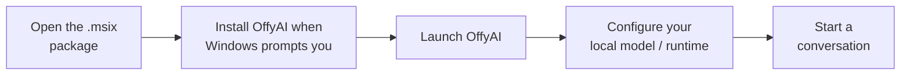
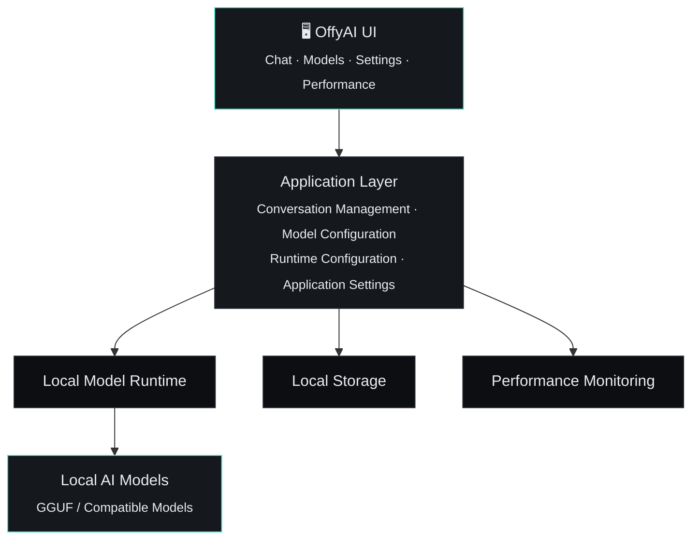
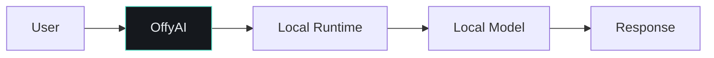

<div align="center">


# OffyAI

### Private. Fast. Local. Yours.

A modern local-first AI desktop application for running and interacting with local Large Language Models.

<p>


</p>

<p>
<a href="#-getting-started"><strong>Get Started</strong></a> ·
<a href="https://github.com/bharat-poojari/offyai/releases"><strong>Releases</strong></a> ·
<a href="https://github.com/bharat-poojari/offyai/issues"><strong>Report a Bug</strong></a> ·
<a href="#-roadmap"><strong>Roadmap</strong></a>
</p>
</div>

<br>

> OffyAI brings a ChatGPT-like experience to your computer while keeping your AI workloads close to you — designed for people who want to **run, manage, and interact with local LLMs** through a clean desktop interface, without depending entirely on cloud-based AI services.

<br>

<table align="center">
<tr>
<td align="center" width="115">🖥️<br><b>Desktop UI</b></td>
<td align="center" width="115">🔒<br><b>Local-first</b></td>
<td align="center" width="115">🤖<br><b>Local LLMs</b></td>
<td align="center" width="115">📦<br><b>Model mgmt</b></td>
<td align="center" width="115">💬<br><b>Chat</b></td>
<td align="center" width="115">⚡<br><b>Perf monitor</b></td>
</tr>
</table>

<br>

## Contents

<table>
<tr>
<td valign="top" width="33%">

- [Highlights](#-highlights)
- [Why OffyAI?](#-why-offyai)
- [Local AI](#-local-ai)
- [Getting Started](#-getting-started)
- [Windows Store Package](#-windows-store-package)
- [Selecting a Model](#-selecting-a-model)

</td>
<td valign="top" width="33%">

- [System Requirements](#-system-requirements)
- [Performance](#-performance)
- [Architecture](#-architecture)
- [Model Management](#-model-management)
- [Chat](#-chat)
- [Configuration](#-configuration)

</td>
<td valign="top" width="33%">

- [Privacy](#-privacy)
- [Internet Connectivity](#-internet-connectivity)
- [Local Data](#-local-data)
- [Troubleshooting](#-troubleshooting)
- [Development & Building](#-development)
- [Contributing / Security / License](#-contributing)

</td>
</tr>
</table>

<br>

## ✨ Highlights

<table>
<tr><td width="50%">

- 🖥️ Modern desktop AI interface
- 🔒 Local-first AI experience
- 🤖 Local LLM support
- 📦 Model management
- 💬 ChatGPT-like conversations
- ⚡ Performance monitoring

</td><td width="50%">

- 🧠 Configurable inference settings
- 💾 Local conversation/application data
- 🧩 Designed for extensibility
- 🚀 Standalone Windows application support
- 🛠️ Developer-friendly architecture

</td></tr>
</table>

<br>

## 🎯 Why OffyAI?

Cloud AI is powerful, but it is not always the right solution. OffyAI focuses on giving users more control over their AI environment.

| Feature | OffyAI |
| :-- | :--: |
| Local AI models | ✅ |
| Cloud-independent inference | ✅ |
| Local-first workflow | ✅ |
| Chat interface | ✅ |
| Model management | ✅ |
| Performance visibility | ✅ |
| Desktop application | ✅ |
| Internet required for every chat | ❌ |
| Data-dependent on cloud inference | ❌ |

> **Your computer. Your models. Your conversations. Your control.**

<br>

## 🧠 Local AI

OffyAI is built around the concept of running AI models locally. Depending on the model and runtime configuration, local inference can provide:

`better privacy` · `offline usage` · `lower dependency on external APIs` · `greater control over models` · `predictable local resource usage` · `experimentation with different open models`

### Model selection

The performance of a local model depends heavily on:

<table>
<tr><td width="50%">

- CPU
- GPU
- VRAM
- RAM

</td><td width="50%">

- Model architecture
- Quantization
- Context length
- Number of inference threads / runtime configuration

</td></tr>
</table>

> [!TIP]
> For the best experience, use a model appropriate for your system hardware.

<br>

## 🚀 Getting Started

### 1 · Download OffyAI

Install OffyAI from the **Microsoft Store**, or download the latest **MSIX** release from the project's [release page](https://github.com/bharat-poojari/offyai/releases).



### 2 · First launch

On the first launch, OffyAI may initialize its local application environment. Depending on the installed version, this can include:

`application configuration` · `local storage` · `model configuration` · `conversation data` · `runtime settings` · `performance preferences`

<br>

## 📦 Windows Store Package

The Windows release target is an **x64 AppX package**, using the **MSIX** package format. Build the unsigned Store-ingestion package from Windows with:

```powershell
npm run build:msix
```

The package is written to `dist-electron\OffyAI-1.1.1-x64.msix` (the version in the filename follows `package.json`).

> [!IMPORTANT]
> The package is intentionally **unsigned** for Microsoft Store submission — Microsoft signs the Store-distributed package after ingestion. A locally unsigned MSIX is **not** intended for direct sideload installation.

**AppX identity**

| Field | Value |
| :-- | :-- |
| Partner Center product | `BharatPoojari.OffyAI` |
| Publisher | `CN=C28C265F-0F23-4459-9938-F0376C861E54` |
| Publisher display name | `Bharat Poojari` |

The package hash can be checked with:

```powershell
Get-FileHash -Algorithm SHA256
```

Microsoft applies the Store-trusted signature after certification.

<br>

## 🧬 Selecting a Model

<table>
<tr>
<td width="33%" valign="top">

**RAM**
Larger models generally require more system memory.

</td>
<td width="33%" valign="top">

**VRAM**
GPU acceleration can significantly improve inference performance when supported.

</td>
<td width="33%" valign="top">

**Quantization**
Reduces memory requirements and can make larger models practical on consumer hardware.

</td>
</tr>
</table>

**Common quantization levels**

<p><code>Q2</code> <code>Q3</code> <code>Q4</code> <code>Q5</code> <code>Q6</code> <code>Q8</code></p>

> [!NOTE]
> The exact performance and quality trade-off depends on the model and runtime.

<br>

## 💻 System Requirements

Actual requirements depend on the model being used.

| | 🟢 Minimum | 🔵 Recommended |
| :-- | :-- | :-- |
| OS | Windows 10 / 11 | Windows 11 |
| CPU | Modern x64 CPU | Modern multi-core CPU |
| RAM | 8 GB | 16 GB+ |
| Storage | Sufficient for models | SSD, 20 GB+ available for multiple models |
| GPU | — | Dedicated GPU, when supported |

> [!IMPORTANT]
> Model requirements can be substantially higher than application requirements. A model's size, quantization, context length, and runtime determine its actual resource consumption.

<br>

## ⚙️ Performance

OffyAI provides performance visibility so users can understand how their local AI workload is behaving. Depending on the version, performance information may include:

`CPU utilization` · `RAM utilization` · `GPU utilization` · `VRAM usage` · `model loading state` · `generation speed` · `token throughput` · `response latency` · `runtime status`

Performance varies significantly between hardware configurations.

<br>

## 🧩 Architecture

OffyAI is designed around a desktop application architecture with separate concerns for the user interface, application logic, local AI execution, storage, and system monitoring.



<br>

## 📦 Model Management

OffyAI is intended to simplify working with local AI models. Typical model-management operations may include:

`adding models` · `selecting models` · `removing models` · `switching between models` · `configuring model parameters` · `monitoring model loading` · `managing model storage`

> [!TIP]
> **GGUF models** — OffyAI can be used with compatible GGUF-based local models when supported by the configured inference runtime. GGUF is commonly used for efficient local inference because it supports quantized model formats suitable for consumer hardware.

<br>

## 💬 Chat

OffyAI provides a conversational interface for interacting with local models. Typical capabilities include:

- New conversations
- Conversation history
- User prompts & model responses
- Multi-turn conversations
- Configurable generation parameters
- Local conversation persistence

The quality of responses depends primarily on the selected model and inference configuration.

<br>

## 🔧 Configuration

Depending on the release, OffyAI may expose settings for:

`model selection` · `temperature` · `context length` · `maximum output tokens` · `CPU threads` · `GPU layers` · `sampling parameters` · `system prompts` · `interface preferences` · `storage configuration`

| Setting | What it does |
| :-- | :-- |
| **Temperature** | Controls randomness in generated responses. Lower values generally produce more deterministic responses; higher values generally produce more varied responses. |
| **Context length** | Determines how much conversation/context the model can process. Larger context windows generally require more memory. |
| **CPU threads** | Controls the amount of CPU parallelism used during inference when supported by the runtime. |
| **GPU layers** | When GPU acceleration is supported, increasing GPU offload can improve performance but requires sufficient VRAM. |

<br>

## 🔐 Privacy

Privacy is a core design principle of OffyAI. The local-first architecture is intended to minimize the need to send prompts and conversations to external AI services.

When using a fully local model/runtime:



No external AI API is inherently required for the local inference path.

> [!IMPORTANT]
> Privacy characteristics depend on the specific OffyAI version, enabled integrations, update mechanisms, and any external services configured by the user.

<br>

## 🌐 Internet Connectivity

OffyAI is designed primarily around local AI workloads. An internet connection may still be useful or required for features such as:

- Downloading the application
- Downloading models
- Checking releases
- Updating the application
- Accessing external integrations
- Repository access

Once the required local model and runtime are available, local inference can operate without sending every prompt to a cloud AI provider.

<br>

## 🗂️ Local Data

OffyAI may maintain local application data such as:

`conversations` · `preferences` · `model configuration` · `runtime settings` · `application state` · `cached information`

The exact storage location and data structure depend on the application version.

### Clearing local application data

If OffyAI provides a reset or clear-data option, use that option when available. For manual troubleshooting, application-local data may need to be removed from the application's configured storage directory.

> [!WARNING]
> Clearing application data can permanently remove local conversations, preferences, cached information, or other stored state. Back up important data before deleting application files.

<br>

## 🛠️ Troubleshooting

<details>
<summary><b>Application does not start</b></summary>
<br>

1. Restart OffyAI
2. Run the latest release
3. Check Windows security/antivirus notifications
4. Verify that required runtime files are present
5. Check application logs, if available
6. Reinstall the application if necessary

</details>

<details>
<summary><b>Model does not load</b></summary>
<br>

- Model file integrity
- Available RAM
- Available VRAM
- Model compatibility
- Quantization
- Context length
- GPU configuration
- Runtime compatibility

Large models can fail to load when insufficient system memory is available.

</details>

<details>
<summary><b>Generation is slow</b></summary>
<br>

Possible causes:
- CPU-only inference
- Insufficient GPU acceleration
- Large model size
- High context length
- High output length
- Low CPU thread utilization
- Insufficient RAM/VRAM
- Model quantization

> [!TIP]
> Try a smaller or more aggressively quantized model if hardware resources are limited.

</details>

<details>
<summary><b>High memory usage</b></summary>
<br>

Large language models can consume substantial amounts of RAM and VRAM. Consider:
- Using a smaller model
- Using a lower quantization
- Reducing context length
- Reducing concurrent workloads
- Closing unnecessary applications
- Using GPU offloading where supported

</details>

<br>

## 🧪 Development

```bash
git clone https://github.com/bharat-poojari/offyai.git
cd OffyAI
```

Install the project's dependencies according to the technology stack used by the current release, then start the development environment using the project's configured development command.

> [!NOTE]
> Development commands may change between releases. Refer to the repository configuration and project documentation for the current commands.

### Building OffyAI


Before publishing a release, verify:

<table>
<tr><td width="50%">

- Application starts correctly
- Models load correctly
- Chat functionality works
- Settings persist correctly
- Local storage works

</td><td width="50%">

- Performance monitoring works
- No development-only files are included
- Required runtime files are packaged
- Windows executable launches on a clean system

</td></tr>
</table>

<details>
<summary><b>📋 Release checklist</b></summary>
<br>

- [ ] Update application version
- [ ] Test application startup
- [ ] Test model loading
- [ ] Test chat generation
- [ ] Test conversation persistence
- [ ] Test settings
- [ ] Test model management
- [ ] Test performance monitoring
- [ ] Test application reset/clear-data behavior
- [ ] Build production executable
- [ ] Test executable on a clean Windows environment
- [ ] Update release notes
- [ ] Create GitHub release
- [ ] Upload executable
- [ ] Verify download

</details>

<br>

## 🗺️ Roadmap

- [ ] Improved model discovery
- [ ] One-click model installation
- [ ] More inference runtimes
- [ ] Better GPU acceleration
- [ ] Advanced performance analytics
- [ ] Conversation search
- [ ] Conversation export/import
- [ ] Custom system prompts
- [ ] Model benchmarking
- [ ] Model comparison
- [ ] Plugin/integration architecture
- [ ] Improved model metadata
- [ ] Automatic update support
- [ ] Cross-platform support

> [!NOTE]
> The roadmap is subject to change based on development priorities.

<br>

## 🤝 Contributing

Contributions are welcome. Before submitting a pull request:

1. Fork the repository
2. Create a feature branch
3. Make your changes
4. Test the changes locally
5. Keep commits focused
6. Update documentation where necessary
7. Submit a pull request

```bash
git checkout -b feature/my-feature
git add .
git commit -m "Add my feature"
git push origin feature/my-feature
```

Then open a pull request against the main development branch.

<br>

## 🐛 Bug Reports

When [reporting a bug](https://github.com/bharat-poojari/offyai/issues), include as much useful information as possible:

<table>
<tr><td width="33%">

- OffyAI version
- Windows version
- CPU / GPU / RAM

</td><td width="33%">

- Model name
- Model quantization
- Runtime configuration

</td><td width="33%">

- Steps to reproduce
- Expected vs. actual behavior
- Error message, logs, screenshots

</td></tr>
</table>

A good bug report makes the issue easier to reproduce and resolve.

<br>

## 🔒 Security

> [!CAUTION]
> If you discover a security vulnerability, avoid publicly posting sensitive exploit details before the issue can be assessed. Report security issues through the project's designated security contact or GitHub Security Advisory process.

<br>

## 📄 License

This project is distributed under the license specified in the repository. See the [`LICENSE`](https://github.com/bharat-poojari/offyai/blob/main/LICENSE) file for the complete license terms.

<br>

## 👨‍💻 Author

**OffyAI** — a local-first AI desktop application focused on:

> **Privacy · Performance · Control · Simplicity**

<br>

## ⭐ Support the Project

If you find OffyAI useful:

<div align="center">

**[⭐ Star the repository](https://github.com/bharat-poojari/offyai)** · 🐛 Report bugs · 💡 Suggest features · 🔧 Contribute improvements · 📢 Share the project

</div>

Every contribution helps improve the project.

<br>

## 📌 Project Status

**Status:** 🟠 Active Development

OffyAI is continuously evolving. Features, interfaces, model compatibility, and system requirements may change between releases. For the latest information, always refer to the current [GitHub repository](https://github.com/bharat-poojari/offyai) and [release notes](https://github.com/bharat-poojari/offyai/releases).

<br>

<div align="center">

## OffyAI

**Local AI. Simplified.**

<sub>Run AI locally.<br>Keep control locally.<br>Build without unnecessary cloud dependency.</sub>

</div>
